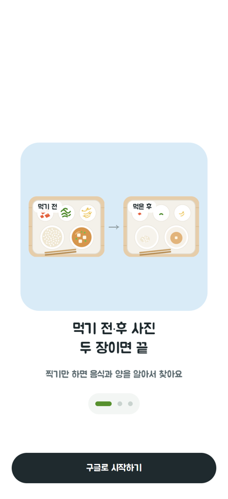
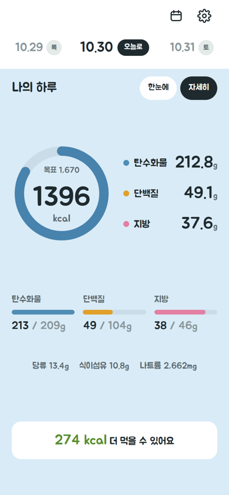
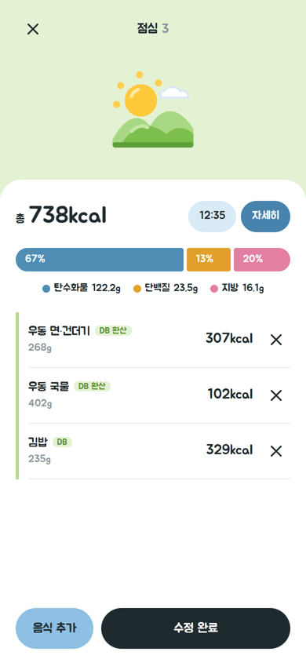
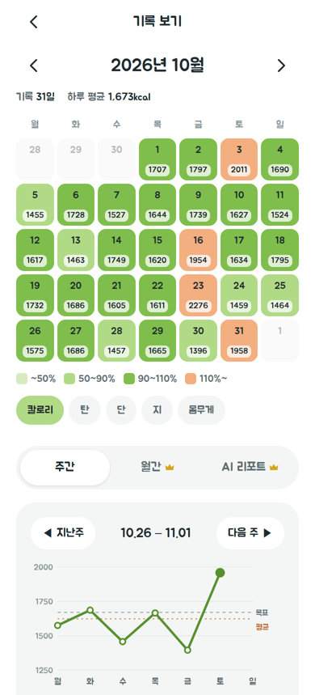
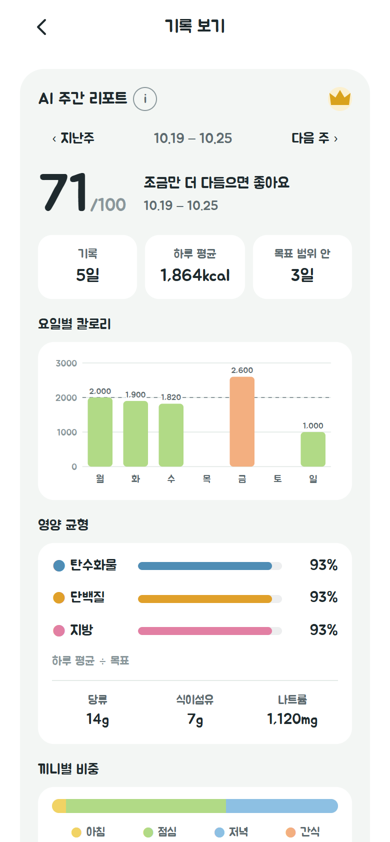
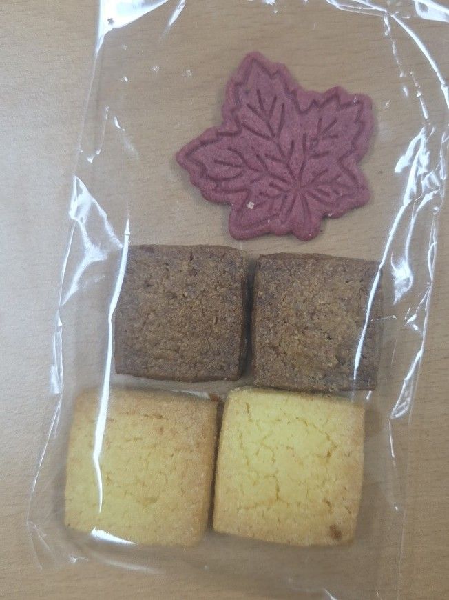
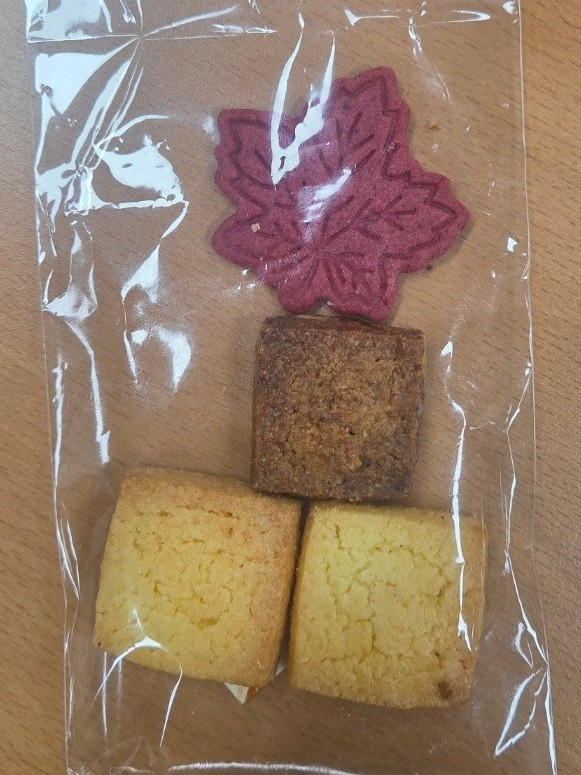
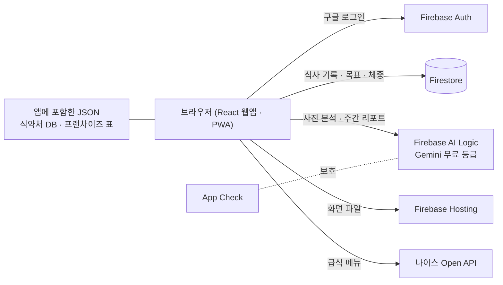

# 인테이크 (Intake)

**먹기 전·후 사진 두 장으로, 실제로 먹은 만큼만 기록하는 식단 앱**

- 배포 주소: **https://meal-intake-2026.web.app**
- 팀 알파고 (구성현 · 안시후) · AI-SW개발 해커톤 2026

## 문제

식단 앱은 대부분 "1인분을 다 먹었다"고 가정합니다. 하지만 실제 식사에서는 밥을 조금 남기고, 국물은 거의 남기고, 반찬은 여럿이 나눠 먹습니다. 반찬을 하나하나 검색해 넣는 일도 번거로워서 기록을 금방 그만두게 됩니다.

## 해결

1. **먹기 전 사진**: AI가 음식 이름과 무게를 추정합니다.
2. **먹은 후 사진**: 두 사진을 비교해 음식마다 남긴 비율을 판단합니다.
3. **계산은 코드가**: 칼로리와 영양소는 식약처 공공데이터로 계산하고, 화면에 출처를 함께 표시합니다.

```
섭취 kcal = 100g당 kcal × 무게(g) ÷ 100 × (1 − 남긴 비율) ÷ 같이 먹은 인원
```

AI가 틀리면 결과 화면에서 이름·무게·남긴 양을 바로 고칠 수 있습니다. 이름을 바꾸면 자동으로 다시 계산합니다.

## 화면

<table>
  <tr>
    <th>시작</th>
    <th>홈</th>
    <th>끼니 기록</th>
  </tr>
  <tr>
    <td></td>
    <td></td>
    <td></td>
  </tr>
  <tr>
    <th>기록 보기</th>
    <th>AI 주간 리포트</th>
    <th></th>
  </tr>
  <tr>
    <td></td>
    <td></td>
    <td></td>
  </tr>
</table>

화면의 값은 테스트용 데이터입니다.

## 주요 기능

| 구분 | 내용 |
| --- | --- |
| 기록 | 카메라 촬영 · 앨범 사진 · 직접 입력(식약처 DB 이름 찾기). 먹은 후 단계에서는 사진 대신 [다 먹었어요] · [남긴 양 직접 고르기]도 고를 수 있음 |
| 칼로리 출처 | `DB`(식약처) · `DB 환산`(100ml 기준 값 환산) · `공식 정보`(프랜차이즈 공식 영양정보) · `공개 중량`(정해진 크기 메뉴) · `AI 추정` |
| 국물 요리 | 면·건더기와 국물을 나눠 국물만 남긴 양을 반영 |
| 하루 요약 | 끼니별 기록, 목표 대비 칼로리·탄단지, 세부 영양소 9가지 |
| 목표 | Mifflin-St Jeor 공식으로 목표 칼로리·탄단지 추천(기초대사량 아래로 내려가지 않음) |
| 기록 보기 | 목표 달성 정도를 진하기로 보여 주는 달력, 주간 추이 그래프, 체중 기록 |
| 학교 급식 | 나이스 급식 메뉴를 AI 인식 후보로 사용 |
| 프리미엄(👑) | AI 주간 리포트(한 주 치마다 3번까지 생성), 남은 영양소 맞춤 음식 추천, 월간 그래프 — 지금은 결제 없이 모두 무료로 열려 있음 |
| PWA | 홈 화면에 추가하면 앱처럼 실행 |

## 심사위원 체험 안내

1. 휴대폰이나 PC에서 https://meal-intake-2026.web.app 에 접속합니다.
2. **[구글로 시작하기]** → 동의 → 목표 질문 몇 개 → 홈.
   - 제출 양식의 **테스트 계정**으로 로그인하면 두 달치 가상 식단이 들어 있어 달력·그래프·AI 주간 리포트를 바로 볼 수 있습니다.
3. 홈의 끼니 카드 **[+]** → **[카메라로 찍기]** 또는 **[앨범에서 고르기]**로 먹기 전 사진을 넣습니다. PC에서는 사진 파일을 고르면 됩니다.
4. 분석이 끝난 끼니를 눌러 **먹은 후 사진**을 넣으면 결과 화면이 나옵니다. 값을 확인하고 **[저장]**합니다.
5. 음식 사진이 없으면 **[직접 입력]**으로 음식 이름을 찾아 기록할 수 있습니다.

> AI 분석은 Gemini 무료 등급을 쓰므로 호출 수에 한도가 있습니다. 요청이 잠깐 몰려 "잠시 후 다시 시도해 주세요"가 나오면 1분쯤 뒤 [다시 시도]를 눌러 주세요. 하루 한도를 다 쓰면 "오늘 AI 분석 한도를 다 썼어요"가 나옵니다. 그때는 [직접 입력]으로 체험해 주세요. 하루 한도는 매일 17:00(KST)에 초기화됩니다.

### 예시 사진으로 해 보기

찍을 음식이 없을 때는 아래 두 장으로 먹기 전·후 비교를 해 볼 수 있습니다. 쿠키 5개 중 갈색 쿠키 1개를 먹은 사진입니다.

<table>
  <tr>
    <th>먹기 전</th>
    <th>먹은 후</th>
  </tr>
  <tr>
    <td><a href="https://github.com/ninecastle/meal-intake/raw/master/docs/samples/cookie_before.jpg"></a></td>
    <td><a href="https://github.com/ninecastle/meal-intake/raw/master/docs/samples/cookie_after.jpg"></a></td>
  </tr>
</table>

1. 사진을 눌러 연 뒤 기기에 저장합니다.
2. 홈의 끼니 카드 **[+]** → **[앨범에서 고르기]**(PC는 **[사진 파일 고르기]**)로 `cookie_before.jpg`를 고릅니다.
3. 분석이 끝나면 끼니 화면에서 "먹은 후 사진 기다림" 음식을 누르고, 같은 버튼으로 `cookie_after.jpg`를 고릅니다.
4. 결과 화면에서 남긴 양과 칼로리를 확인하고 **[저장]**합니다. 값이 다르면 그 자리에서 고칠 수 있습니다.

두 사진은 같은 기기에서 넣어 주세요. 먹기 전 사진은 그 기기에만 잠깐 보관합니다.

## 구조

서버 코드 없이 Firebase Spark(무료) 요금제 안에서만 동작합니다.



- **모델은 보고, 코드는 계산합니다.** Gemini는 음식 이름·무게·남긴 비율만 답하고, 칼로리·영양소는 앱 코드가 계산합니다.
- **사진은 우리 서버(Firebase)에 저장하지 않습니다.** 분석을 위해 Google Gemini API로만 보내며, 무료 등급 약관상 Google이 서비스 개선에 사용할 수 있습니다. 먹기 전 사진은 먹은 후 분석 때까지 기기(IndexedDB)에만 잠깐 두고 지웁니다. 설정에서 "식사 사진 보관"을 켠 경우에만 작은 썸네일을 Firestore에 보관합니다(기본 꺼짐).
- 하루 요약·목표·달력·그래프·음식 추천은 AI 호출 없이 기기에서 계산합니다.

## 한계

- 사진의 조명·각도에 따라 무게와 남긴 비율 추정이 달라질 수 있습니다. 그래서 결과 화면에서 고칠 수 있게 했습니다.
- 식약처 DB와 프랜차이즈 공식 정보에 없는 음식은 AI 추정 값이며, 화면에 `AI 추정`으로 표시합니다.
- Google 검색 기반 영양값 조회(검색 그라운딩) 단계는 무료 등급에서 쓸 수 없어 구현하지 않았습니다. 코드에는 자리만 있습니다.
- 사진 원본을 남기지 않으므로 저장한 뒤에는 사진을 다시 분석할 수 없습니다.

## 기술 스택

React 19 · TypeScript · Vite · Tailwind CSS · React Router · Firebase(Auth, Firestore, Hosting, AI Logic, App Check) · Gemini `gemini-3.5-flash-lite` · 글꼴 Jua

## 폴더 구조

```
web/               웹앱 (React + Vite)
  src/pages/       화면
  src/analysis/    AI 호출 · 칼로리 계산 · 목표 계산
  src/data/        Firestore 읽기·쓰기
  public/data/     식약처 DB · 프랜차이즈 · 1인분 · 국물 비율 JSON
firestore.rules    Firestore 보안 규칙
firestore-tests/   보안 규칙 테스트
spike/             개발용 시험 스크립트(spike/README.md)
_workspace/        설계 문서 · 평가 기록 · 디자인 시안
```

## 로컬 실행

```bash
cp web/.env.example web/.env.local   # 값은 직접 채웁니다. .env.local은 커밋하지 않습니다.
npm --prefix web install
npm --prefix web run dev              # VITE_AI_MOCK=1이면 AI 대신 목업 응답

# 에뮬레이터(Auth · Firestore)로 실행: .env.local에 VITE_USE_EMULATORS=on
firebase emulators:start --only auth,firestore

# 보안 규칙 테스트
npm --prefix firestore-tests install
npm --prefix firestore-tests test
```

## 영양 정보 출처

- 식품의약품안전처 「식품영양성분 데이터베이스」(음식 표준데이터), 공공데이터포털
- 프랜차이즈 메뉴: 각 브랜드 공식 홈페이지 영양정보(행마다 출처 주소와 확인 날짜를 `web/public/data/franchise-*.json`에 기록)
- 학교 급식: 나이스 교육정보 개방 포털 급식식단정보

이 앱의 칼로리·목표는 참고용이며 의학적 조언이 아닙니다.

## 팀

**팀 알파고** — 구성현 · 안시후
